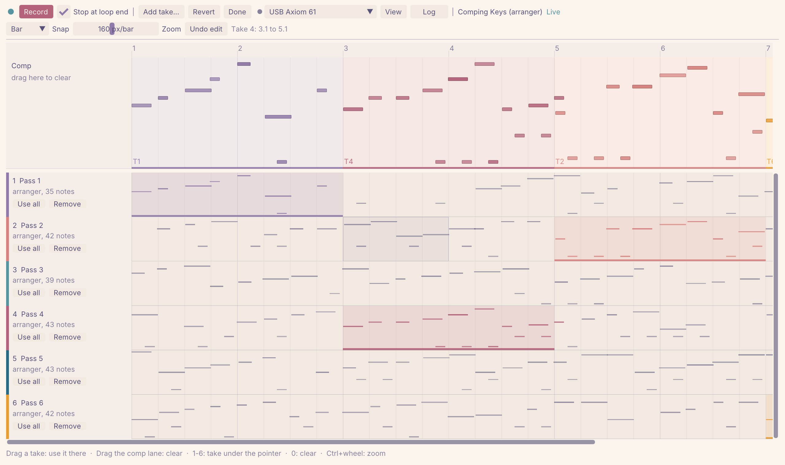
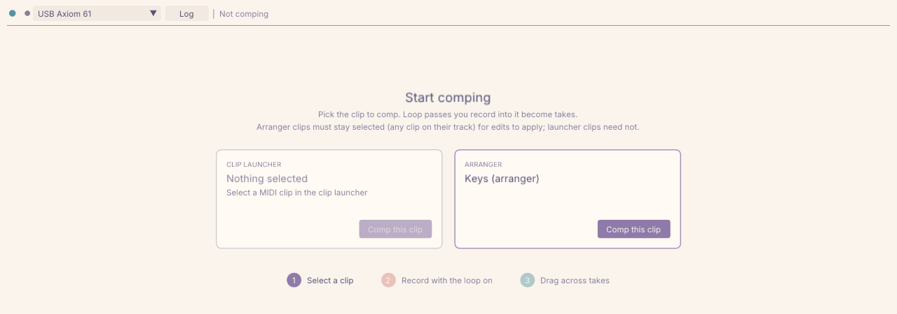
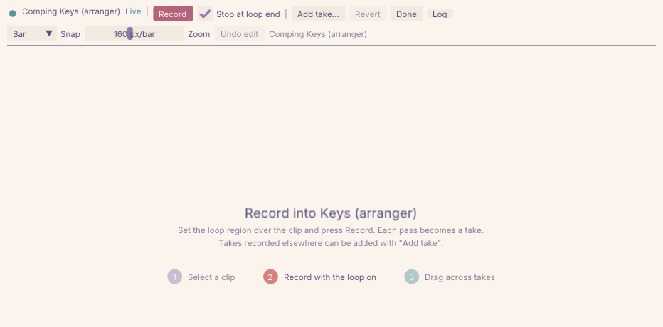
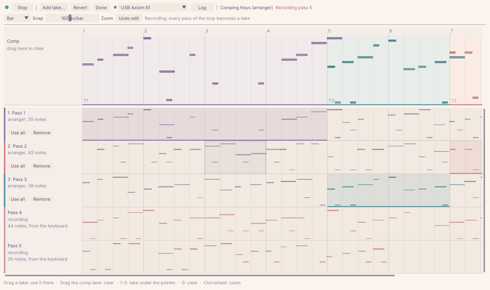
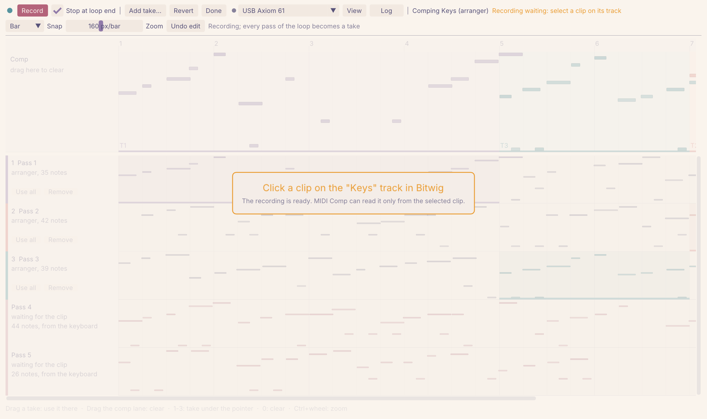
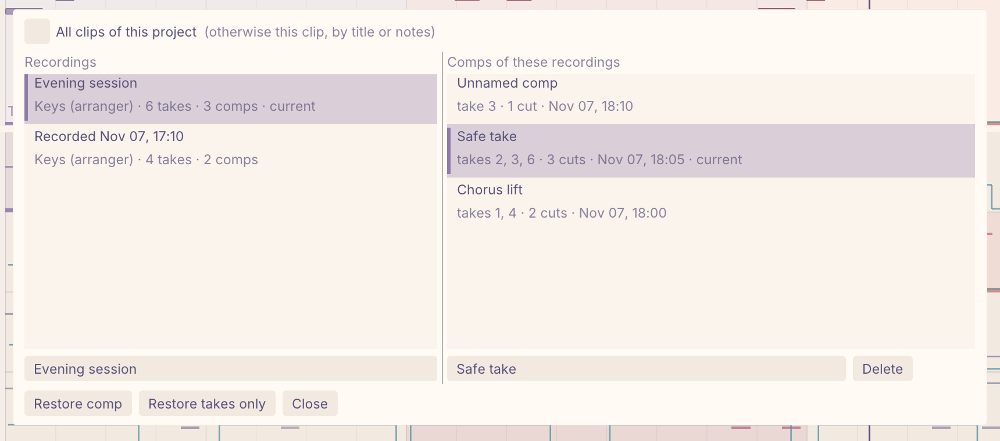
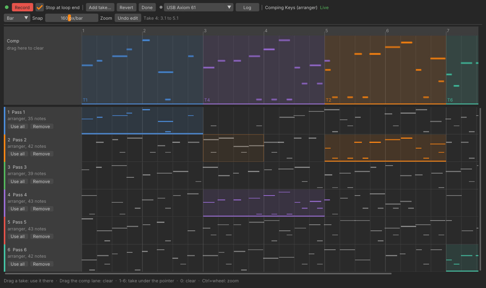

# MIDI Comp

Comping for MIDI clips in Bitwig Studio: record loop passes into a clip, then cut the passes
together in a companion app while the clip updates live.
[Project page](https://bitwig-comp.protagon.space/).

Even though I write code for a living, this is purely vibe-coded so take it for what it is. Without LLMs I'd never have taken on this task and so far the tool seems to be quite useful. Feel free to report bugs :).

Two parts:

- **Extension** (`MidiComp.bwextension`): a Bitwig controller extension that captures takes,
  writes the comp into the clip, and serves a local HTTP API ([API.md](API.md)).
- **Companion app** (`midicomp-companion`): a native editor (Dear ImGui) that shows the takes and
  the comp. It follows the colors of the [Bitwig Theme Editor](https://github.com/Berikai/bitwig-theme-editor).



## Workflow

1. **Pick the clip.** Select a MIDI clip in Bitwig (launcher or arranger). The start screen
   shows what is selected; press *Comp this clip*. The clip's current notes become the first take.

   

2. **Record.** Set the loop region over the clip and press *Record* in the companion (arranger
   clips; a clip on the comp track must be selected). It empties the clip, so the comp is not
   heard, and records from the loop start. With *Stop at loop end* (default) recording stops after
   one pass; without it, it continues until you press *Stop*, and every loop pass becomes a take.
   Bitwig deselects the clip while it records, so when recording stops, click a clip on the comp
   track in Bitwig; the companion grays out the lanes until you do. The passes then become takes
   and the comp is written back. For launcher clips, record in Bitwig with the clip's loop on;
   each pass becomes a take.

   

   Without overdub, Bitwig keeps only the most recent pass at each loop position, and it hides
   the arranger clip from extensions while it records. The companion therefore reads your
   keyboard itself (picker in the toolbar; it opens the first keyboard it finds and remembers
   your choice) and sends the notes with their timestamps to the extension, which records the
   transport position against the same clock. When recording stops, the takes are assembled:

   - Notes Bitwig kept are used as they are (exact timing, every attribute) in the pass they
     were played in. They are matched to the played notes per key, in order of loop position.
   - Played notes Bitwig overwrote are rebuilt from the keyboard data: timing from the
     timestamps, velocities and length from the MIDI messages, other attributes copied from a
     recorded note.
   - The constant delay between the keyboard timestamps and Bitwig's recording is measured on
     the matched notes and removed before notes are assigned to passes, so a note played just
     before or after the loop start lands in the right pass. *Log* reports the remaining
     deviation in milliseconds.

   While recording, the passes appear as provisional lanes (red notes, from the keyboard), and
   are replaced by the assembled takes when recording ends. Without a keyboard selected, the
   recording becomes a single take. Bitwig and the companion both need the keyboard (see
   *Sharing the keyboard* below). *Log* shows what the extension saw (recording, loop wraps,
   assembled takes).

   

3. **Comp.** Drag across a take lane to use that take for the range (snapped to the *Snap* grid);
   drag across the comp lane to make a range silent. The clip is rewritten as you edit, and a
   line shows the playhead. For arranger clips, click the ruler to move it (snapped to the grid,
   `Shift` for any position); this works once the clip has played, so the companion knows where
   the clip starts. In a launcher clip from *Play in launcher*, moving the playhead restarts the
   clip and the arrangement together at that position (Bitwig cannot move a playing launcher
   clip). Each new pass is added as a lane. While the comp still uses a single take
   throughout, it switches to the new pass, as with Bitwig's audio takes; once takes are cut
   together, the comp stays as it is.

4. **Finish.** *Done* ends the session; the clip keeps the comp. *Revert* restores the clip as it
   was before the session and ends it. With pedals or other controllers, see
   [Pedals and controllers](#pedals-and-controllers-cc).

Takes recorded elsewhere (another track or launcher slot) can be added with *Add take*, which
copies the selected clip's notes. They must start at the same position as the comp clip. A take is
a copy: recording over or editing the source clip later does not change it, so the same clip can
be recorded again and added as another take.

**Editing keys** (pointer over the lanes): `1`-`9` use the n-th take for the grid cell under the
pointer, `0` or `Delete` clears it, `Ctrl+Z` undoes the last edit, `Ctrl`+wheel zooms,
`Shift`+wheel scrolls. Take lanes scroll vertically below the fixed comp lane. Double-click a
take's name to rename it (`Enter` keeps the name, `Escape` cancels).

**Transport keys** (while comping, outside text fields): `Space` plays or stops Bitwig, like
the play button at the start of the toolbar; for arranger clips, `Left` and `Right` move the
playhead by one grid cell (`Shift`: one beat) and `Home` moves it to the start of the clip.
With *Record*, recording can be run entirely from the companion.

**Overwriting.** The comp clip is always overwritten with the comp: edits made to it directly in
Bitwig are replaced at the next comp change, and recorded passes are replaced once recording
stops (by then they are takes). Comps are built from the full notes (every attribute the API
exposes); the companion only displays a reduced form.

**Selection (arranger).** Bitwig only lets extensions read and write the *selected* arranger
clip, and arranger clips cannot be pinned. Any clip on the comp clip's track counts, so selecting
something on another track pauses writing until a clip on that track is selected again. Bitwig
also deselects the clip when recording, so after each recording a click on a clip of the track is
needed to turn the recording into takes. While a click is needed, the companion grays out the lanes and
says which track to click. Launcher clips are pinned by the session and have no such limit.



**Saved comps.** The companion saves the current comp shortly after every change, one file per
session, keeping the ten newest unnamed saves per clip and every named one. Give a comp a name
in the *Comp name* field to find it again. When you comp a clip with a saved comp in the same
project, a banner offers *Restore*, and the start screen notes it. *Saved comps...* (or
*Choose...* in the banner) separates recordings from comps: on the left the recording sets
(saved comps with the same takes, titled by when they were first saved), on the right the comps
cut from the selected set, each distinct cut once, with the takes it uses and its number of
cuts. Both can be renamed in the fields below the lists, and comps deleted (recording names are
kept in `recordings.json`). It lists the comps of this clip (by title, or by the notes it holds,
for a copy or a renamed clip); *All clips of this project* shows the rest. The best guess is
selected. *Restore comp* brings back takes and cuts, *Restore takes only* the takes with a new
comp that uses the first take throughout. Files live in
`~/.local/share/midicomp/comps` (Linux, or `$XDG_DATA_HOME`), `~/Library/Application
Support/midicomp/comps` (macOS) or `%APPDATA%\midicomp\comps` (Windows); `--store-dir`
changes it. Saved comps contain every note attribute and are restored at full fidelity, also
after a change of the timing resolution.



**Versions.** For launcher clips, *New version* duplicates the clip into another slot and
continues comping the copy with the same takes and cuts; the original keeps its comp. The copy
gets a version suffix in its title ("Lead" becomes "Lead v2"), so its comps are saved under their
own name. For arranger clips, duplicate the clip to another track in Bitwig and comp the copy;
the banner offers to continue with the comp. The API identifies arranger clips only by their
track, so a copy on the same track would receive every edit as well.

### Pedals and controllers (CC)

Hi-hat pedals, sustain pedals, mod wheels and pitch bend send control messages rather than
notes. MIDI Comp records them with the takes and comps them along with the notes. The extension
API can only write notes into clips, though, so the controllers reach Bitwig through MIDI files,
which Bitwig imports as clip automation.

1. **Record** as usual. The companion reads control messages (CC, channel pressure, pitch bend)
   from the keyboard together with the notes, including each controller's position before
   recording starts, such as a hi-hat pedal held closed. Lane headers show how many a take has,
   and the lanes draw them as curves along the bottom: sustain in green, pitch bend in the
   accent color, other controllers muted.
2. **Comp** as usual. Each cut brings its take's control messages and starts with the take's
   controller values at the cut, so a cut never inherits the previous take's hi-hat opening or
   sustain.
3. **Listen in the launcher** (arranger comps). *Play in launcher* puts the part of the comp
   inside the arranger loop region, with its controllers, into a launcher clip that plays in
   sync with the arrangement, while the other tracks keep playing from the arranger. The clip
   is exactly one loop long, launched on the coarsest grid that fits the loop, and comes in at
   the loop start (with the transport stopped, playback starts there). The session continues
   in that clip, with the same takes and cuts: about a second after each edit, the clip is
   replaced by the new comp with its controllers. The play button, `Space`, the ruler and the
   arrow keys start and move playback, clip and arrangement together.
4. **Back to the arranger.** *Back to arranger* merges the edits into the full comp, returns the
   track to the arrangement, removes the launcher clips MIDI Comp made and continues the
   session in the arranger clip (select it first), which gets the comp's notes. It then loads
   the whole comp with its controllers into a free launcher slot of the track (as *Load into
   Bitwig* does); copy that clip over the arranger clip in Bitwig (copy and paste, or drag).
   This copy is manual, because copying and pasting through the API loses the automation.

Comps of launcher clips need no extra steps: their clip is replaced with the comp and its
controllers after each edit. *Load into Bitwig* does the same on demand.

- Until a comp is loaded, the clip holds the automation Bitwig recorded, which belongs to the
  last recorded pass, not to the comp.
- The clip's original content (the first take) has no control messages: the API cannot read
  them.
- Replacing a launcher clip resets its settings, such as color and launch options. Clips from
  *Play in launcher* get their loop and launch quantization back.
- Clips MIDI Comp loaded into other slots are reused for later loads and removed by *Back to
  arranger*, as long as their names are unchanged. The MIDI files are kept in
  `~/.midicomp/midi`. They contain no tempo, so Bitwig does not ask about one.

### Preview (prototype)

*Preview* (arranger comps) plays the comp, controllers included, as live MIDI into the comp
track, while the clip stays empty: edits are heard at once, and nothing is written into the
clip until the preview ends, which writes the comp back. For controllers in the final clip, use
*Load into Bitwig* afterwards as usual.

Setup, once:

1. The companion has a virtual MIDI output, "MIDI Comp" / "Preview". On macOS it appears in
   Bitwig directly; on Linux the [MIDI copies](#midi-copies-on-linux) service copies it to a
   VirMIDI port (`midi-copies list` shows which). Windows has no virtual ports.
2. In Bitwig, add a *Generic > MIDI Keyboard* controller with that port as its input, and set
   the comp track's input to it.
3. Optional, for better timing: send Bitwig's MIDI clock to the same device (*Settings >
   Synchronization*). The companion reads it back; without it, timing comes from the
   extension's view of the transport, which is coarser.

During a preview the extension turns the track's input monitoring on, and the companion plays
the comp while Bitwig plays, following loops, seeking and stopping. *Preview lead* in *View*
sends the MIDI earlier, to make up for Bitwig's output latency. The tooltip of *Preview* shows
the timing source in use. Live MIDI is not sample-accurate: expect a few milliseconds of
variation, more without MIDI clock.

## Installation

Download the extension and the companion for your platform from the
[releases](../../releases) or the latest CI run, or build them (below).

1. Copy `MidiComp.bwextension` to `~/Bitwig Studio/Extensions/` (Windows:
   `Documents\Bitwig Studio\Extensions`).
2. In Bitwig: *Dashboard > Settings > Controllers > Add controller > Utility > MIDI Comp*. It
   has no MIDI ports.
3. Start `midicomp-companion`. It finds the extension through `~/.midicomp/endpoint.json`, which
   the extension writes on startup, and reconnects when the extension restarts. Pick your
   keyboard in the toolbar if it is not chosen automatically; the choice is kept in
   `keyboard.txt` next to the saved comps.

### Sharing the keyboard

- **macOS**: CoreMIDI devices serve several programs; nothing to do.
- **Linux**: Bitwig opens raw MIDI devices exclusively, and once the companion reads the keyboard
  through the ALSA sequencer, the kernel holds the keyboard's raw device and Bitwig reports it as
  busy. The fix is a copy of each device on a virtual raw MIDI device (`snd-virmidi`): Bitwig
  uses the copy, the companion reads the device itself. See [MIDI copies on
  Linux](#midi-copies-on-linux).
- **Windows**: classic MIDI drivers allow one program per device. Use a driver with
  multi-client support (Windows MIDI Services) or route the keyboard through a loopback port
  for Bitwig.

### MIDI copies on Linux

[`tools/midi_copies.py`](tools/midi_copies.py) gives every MIDI device a copy on a virtual raw
MIDI port: it connects each readable port of each device to its own virtual port, and the
virtual port back to the device, so messages from Bitwig (such as LEDs on a controller) reach
the hardware. Devices plugged in later are picked up within two seconds. Each device port keeps
its copy across replugging and reboots; when all copies are taken, the copy of the device seen
least recently is reused.

In Bitwig, select the copies ("VirMIDI 16-0", ...) instead of the devices, in the controller
settings for each controller that uses them. In the companion, select the device itself (the
automatic choice skips the copies). Reading a copy does not show the device's notes: what
arrives at a copy goes out on its raw device, which Bitwig has open.

The copies cannot be renamed: the kernel names them after their card and device number. A
fixed card number keeps the names the same, and `midi-copies list` shows which copy belongs to
which device and how Bitwig lists it. Bitwig numbers the devices in order ("Virtual Raw MIDI",
"Virtual Raw MIDI 2", ...) and lists each with sixteen subdevices ("/1" to "/16"), which all
carry the same data; use "/1". With a keyboard that has two ports, of which only the first
accepts input:

```
$ midi-copies list
VirMIDI 16-0   (Bitwig: Virtual Raw MIDI/1)   <- USB Axiom 61:USB Axiom 61 MIDI 1 (and back)
VirMIDI 16-1   (Bitwig: Virtual Raw MIDI 2/1) <- USB Axiom 61:USB Axiom 61 MIDI 2
VirMIDI 16-2   (Bitwig: Virtual Raw MIDI 3/1) <- MIDI Comp:Preview
VirMIDI 16-3   (Bitwig: Virtual Raw MIDI 4/1) <- (free)
```

**NixOS.** The flake provides a module:

```nix
{
  imports = [ midi-comp.nixosModules.midi-copies ];
  services.midi-copies.enable = true;
  # services.midi-copies.copies = 8;            # virtual ports (default 4, at most 16)
  # services.midi-copies.firstCard = 16;        # card number of the copies
  # services.midi-copies.exclude = [ "Midi Through" ];
}
```

The kernel module options take effect after a reboot (or after reloading `snd-virmidi` while no
program uses it).

**Other distributions.** Load the kernel module with a fixed card number and run the script
(Python 3 and `aconnect` from alsa-utils; the user needs access to `/dev/snd/seq`, usually the
`audio` group):

```sh
echo 'options snd-virmidi index=16 midi_devs=4' | sudo tee /etc/modprobe.d/virmidi.conf
echo snd-virmidi | sudo tee /etc/modules-load.d/virmidi.conf
sudo modprobe snd-virmidi
python3 tools/midi_copies.py run          # keep it running, e.g. as a systemd user service
```

**Checking the copies.**

- `aconnect -l` lists the sequencer connections: the device's port shows `Connecting To` the
  copy's client, and the copy shows `Connected From` the device.
- `amidi -l` lists the raw devices; `amidi -p hw:16,0 -d` prints what arrives at the first copy
  while you play (close Bitwig first, it holds the device). With running status the status byte
  is sent once, so following notes show two bytes, e.g. `37 34` and `37 00` for note on and off.
- `aseqdump -p 'USB Axiom 61:0'` prints what the device itself sends, also while Bitwig runs.
- `journalctl -u midi-copies` (NixOS) shows the assignments as devices appear.

### Companion options

- `--theme-dir DIR`: Bitwig Theme Editor directory (default `~/.bitwig-theme-editor`).
- `--endpoint FILE`: discovery file (default `~/.midicomp/endpoint.json`).
- `--store-dir DIR`: where saved comps are kept.
- `--screenshot FILE`: render for three seconds, save the window as PPM and exit.
- `--demo-keyboard NAME`: show `NAME` in the keyboard picker without opening MIDI (screenshots).
- `--scale FACTOR`: UI scale on top of the display's scale, for this run (0.5 to 4).
- `--open-saved-comps`: open the list of saved comps (screenshots).
- `MIDICOMP_FONT=/path/to/font.ttf`: UI font. Release builds embed Roboto; the Nix build uses Inter.

The UI follows the display's scale (also when the window moves to another display). *View* in
the toolbar, or `Ctrl+=`, `Ctrl+-` and `Ctrl+0`, adjusts it further. *View* also sets the height
of the take lanes (fit to the window, or fixed). Both are kept in `settings.json` next to the
saved comps.

### Theme

Colors come from the [Bitwig Theme Editor](https://github.com/Berikai/bitwig-theme-editor): `bte_config.txt` selects the global `theme.bte` or the
per-version theme, layered over the newest `versions/*/default.bte`. Lanes use the timeline
background and header colors, grid lines the grid colors, drag previews the time-selection colors,
and takes the panel color set. Missing entries fall back to Bitwig's stock dark colors. The files
are re-read once a second, so changes in the theme editor apply without a restart.



## Building

The repository is a Nix flake. If the checkout sits inside another git repository where it is
untracked, use `path:.` instead of `.` so that Nix sees all files.

```sh
nix develop                      # or: direnv allow
mvn package                      # extension + tests -> target/MidiComp.bwextension
nix build .#companion            # companion -> result/bin/midicomp-companion
```

Without Nix, the companion needs CMake 3.25, a C++23 compiler, OpenGL and, on Linux, the ALSA
headers (`libasound2-dev` on Debian and Ubuntu). GLFW, Dear ImGui, nlohmann/json, cpp-httplib and
RtMidi are used when installed and downloaded otherwise:

```sh
cmake -S companion -B build -DCMAKE_BUILD_TYPE=Release
cmake --build build --config Release
ctest --test-dir build -C Release
```

GitHub Actions (`.github/workflows/build.yml`) builds the extension, the companion for Linux,
macOS and Windows, and the Nix package; tags `v*` publish a release with all artifacts.

**clangd.** The Nix compiler wrapper passes dependency include paths through environment
variables, not `compile_commands.json`. Start clangd inside `nix develop` with
`--query-driver=/nix/store/**/bin/*`.

### Regenerating screenshots

The images in `docs/screenshots` are rendered headless with Xvfb and Mesa's software renderer
against a mock of the API:

```sh
python3 tools/mock_api.py 18799 /tmp/mock-endpoint.json session &   # or: start, record, recording, select
env -u WAYLAND_DISPLAY LIBGL_ALWAYS_SOFTWARE=1 xvfb-run -a -s "-screen 0 2560x1520x24" \
  ./companion/build/midicomp-companion --endpoint /tmp/mock-endpoint.json \
  --demo-keyboard "USB Axiom 61" --scale 2 --screenshot out.ppm
```

For `comps.png`, write sample saved comps with `python3 tools/mock_store.py DIR`, pass
`--store-dir DIR --open-saved-comps`, and crop to the popup (1720x760 at 420,385). Screenshots
ignore the mouse, so no hover effects show.

GLFW prefers Wayland when `WAYLAND_DISPLAY` is set, so without unsetting it the window opens on
the desktop instead of Xvfb. Pass `--theme-dir` with an empty directory for stock colors; the
README images use Rose Pine Dawn and, in the Theme section, the stock colors. `start.png` and
`record.png` are cropped to 900 and 690 pixels in height. The project page's
`session-detail.png` (1480x1000 at 0,120) and `session-cc.png` (1500x860 at 0,560) are crops of
`session-rose-pine-dawn.png`.

## Limitations

- **Timing resolution.** The API exposes notes through a step grid (16384 steps here); a note's
  start is the step it falls in. Each session picks the finest step at which its clip fits, from
  1/4096 beat down to 1/64 beat: an 8-beat clip gets 1/2048 beat (0.25 ms at 120 BPM), a 32-bar
  clip 1/512 beat (1 ms). Clips longer than 256 bars cannot be fully accessed.
- **Copied attributes.** Velocity, release velocity, duration, pan, timbre, pressure, gain,
  transpose, chance, occurrence, recurrence, repeats and mute. Drawn per-note expression curves and
  clip automation (CC, pitch bend) are not exposed by the API: the editor cannot read or write
  them. Control messages played on the keyboard while recording are kept with each take and
  comped along with the notes; *Load into Bitwig* brings them into the clip (see *Finish*).
- **Arranger clips** are identified by track; the API exposes no clip position. A clip on the comp
  clip's track must be selected for changes to be written (see Selection). Clips must not be
  trimmed on the left edge, and clip loops must not repeat inside the comp.
- **Clip length.** Nothing is written past the end of the comp clip; the status shows when the
  comp is longer than the clip.
- **Undo.** Each note edit is a separate step in Bitwig's undo history. *Undo edit* in the
  companion reverts comp edits; *Revert* restores the clip's original content.

### Untested in Bitwig

These behaviors come from the API documentation and have not been verified in Bitwig yet:

- Launcher recordings: the recording state is read from the clip slot and loop passes from the
  clip's playing step. (Arranger recordings, read from the transport, have been tested.)
- When a cursor moves to another clip, the host reports `Empty` for the old notes and `NoteOn`
  for the new ones within the 150 ms settle window.
- A 16384 x 128 grid does not cost much memory or CPU in the host.

## License

MIT, see [LICENSE](LICENSE). Release builds of the companion include Dear ImGui, GLFW,
nlohmann/json, cpp-httplib and RtMidi (all MIT or similarly permissive) and the Roboto font
(Apache 2.0).
